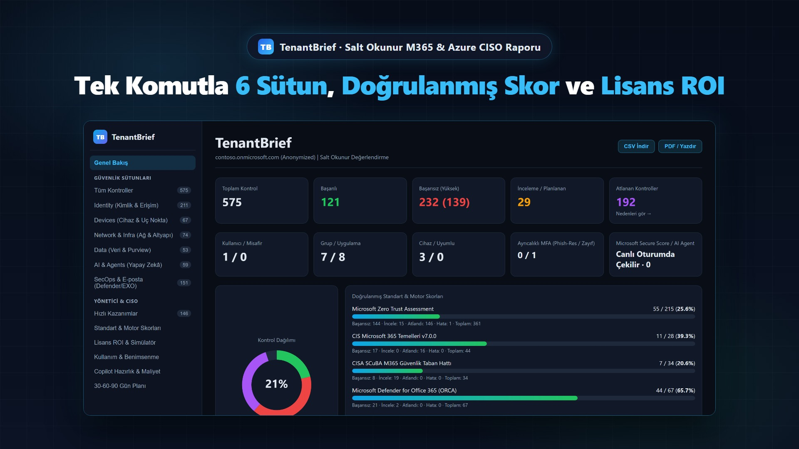

<div align="center">

# TenantBrief

**Strictly read-only, zero-telemetry Microsoft 365 & Azure CISO security posture and license ROI assessment (`EN / TR`)**

[](https://github.com/canercetinkaya/TenantBrief/actions/workflows/ci.yml)
[](https://github.com/canercetinkaya/TenantBrief/releases)
[](LICENSE)
[](https://learn.microsoft.com/powershell/)
[](tests/)

*Unifies `Microsoft ZeroTrustAssessment`, `CISA ScubaGear 2.0`, `Microsoft ORCA`, `Maester` (`EIDSCA` / `CIS M365 v7.0.0` / `XSPM`), and optional `EntraFalcon` exports in a single local run across **6 security pillars**, **verified benchmark scores** (no synthetic framework averages), **32-SKU R1–R7 license waste visibility**, and **Microsoft 365 Copilot readiness** — without modifying a single tenant setting.*

<br/>

[](https://canercetinkaya.com/en/blog/tenantbrief-m365-lisans-roi-uyumluluk-analizi/#demo-video)

[🇹🇷 Türkçe README](README.md) · [🌐 English Architecture Essay](https://canercetinkaya.com/en/blog/tenantbrief-m365-lisans-roi-uyumluluk-analizi/) · [📖 Türkçe Mimari İnceleme](https://canercetinkaya.com/tr/blog/tenantbrief-m365-lisans-roi-uyumluluk-analizi/) · [📊 Live Demo (EN)](demo/TenantBriefReport-EN.html) · [📄 CISO Executive PDF (EN)](demo/TenantBrief-ExecutiveSummary-EN.html)

</div>

---

## Why TenantBrief?

| Enterprise Bottleneck | TenantBrief Approach |
| :--- | :--- |
| **Fragmented scanner tabs & duplicate triage** | Consolidates findings into **6 core security pillars** (`Identity`, `Devices`, `Network`, `Data`, `AI`, `SecOps`) with a **42-control crosswalk** preserving source provenance badges. |
| **Misleading synthetic compliance percentages** | Excludes invented framework averages; scores only the benchmarks actually executed (`ZeroTrustAssessment`, `CIS M365 v7.0.0`, `CISA SCuBA`, `ORCA`, `EIDSCA`, `XSPM`, `EntraFalcon`) before deduplication. |
| **Idle M365 E3/E5 & Copilot license waste** | Evaluates live `/subscribedSkus` and `/users` data across **32 SKUs** for **R1–R7 waste categories**, 10 overlap rules, and **L1–L4 Copilot readiness** (list-price baseline; reconcile with EA/CSP rates). |
| **Repeated login prompt fatigue** | Supports zero-prompt certificate app authentication (`Initialize-TenantBriefApp` + `Connect-TenantBrief -UseAppAuth`) or interactive `-Profile Quick` (0–3 prompts) with zero tenant app registration. |
| **Production safety & zero external telemetry** | **100% read-only**, zero external cloud/AI uploads, strict offline CSP (`default-src 'none'`), HTML-escaped JSON, light/dark report theme, and `-Anonymize` masking. |

---

## Quick Start

### 1. Interactive Quick Run (Zero Tenant App Registration)

```powershell
git clone https://github.com/canercetinkaya/TenantBrief.git
cd TenantBrief
Import-Module .\TenantBrief.psd1 -Force

# Read-only prerequisite & auth plan check
Test-TenantBriefPrerequisites
Test-TenantBriefPrerequisites -AuthPlan

# Connect strictly read-only and generate offline EN executive report
Connect-TenantBrief
Invoke-TenantBriefAssessment -OutputPath "$HOME\TenantBriefReport" -Language en -Framework All
```

### 2. Zero-Prompt Unattended App-Only Mode (X.509 Certificate)

```powershell
Import-Module .\TenantBrief.psd1 -Force
Initialize-TenantBriefApp
Connect-TenantBrief -UseAppAuth
Invoke-TenantBriefAssessment -OutputPath "$HOME\TenantBriefReport" -Language en -Framework All

# Full clean rollback whenever needed
Initialize-TenantBriefApp -Remove
```

See [docs/unattended-auth.md](docs/unattended-auth.md) for the exact least-privilege read-only permission matrix, and [NOTICE.md](NOTICE.md) for upstream open-source attributions.

---

## Further Reading

- [TenantBrief: Unifying Microsoft 365 Security Posture and License Waste on One Decision Surface (EN)](https://canercetinkaya.com/en/blog/tenantbrief-m365-lisans-roi-uyumluluk-analizi/)
- [TenantBrief: Microsoft 365 Güvenlik Duruşunu ve Lisans İsrafını Tek Karar Yüzeyinde Buluşturmak (TR)](https://canercetinkaya.com/tr/blog/tenantbrief-m365-lisans-roi-uyumluluk-analizi/)
- [More Enterprise M365, Entra ID, Purview & Defender XDR Guides](https://canercetinkaya.com/en/blog/)
