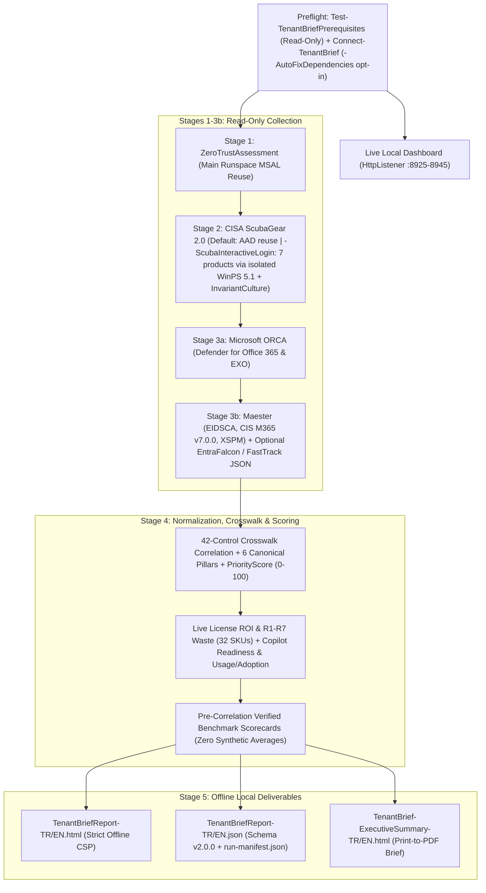

# TenantBrief

**Read-only, zero-telemetry Microsoft 365 & Azure CISO assessment brief (`TR / EN`).**
Unifies `ZeroTrustAssessment`, `CISA ScubaGear 2.0`, `Microsoft ORCA`, `Maester` (`EIDSCA` / `CIS M365 v7.0.0` / `XSPM`), and optional `EntraFalcon` JSON into **6 canonical security pillars**, **verified per-benchmark scores**, **32-SKU License ROI / R1–R7 waste audits**, and **Copilot readiness** — locally, with zero external AI exposure.

> **Architecture & Deep-Dive Article:**
> - **Turkish:** [TenantBrief: Salt Okunur M365 Lisans İsrafı, 6 Güvenlik Sütunu ve Doğrulanmış Standart Skorlama Mimarisi](https://canercetinkaya.com/tr/blog/tenantbrief-m365-lisans-roi-uyumluluk-analizi)
> - **English:** [TenantBrief: Read-Only M365 License Waste, 6 Unified Pillars, and Verified Benchmark Scoring](https://canercetinkaya.com/en/blog/tenantbrief-m365-lisans-roi-uyumluluk-analizi)
> - **Live Demo Reports:** [TR Interactive](demo/TenantBriefReport-TR.html) · [EN Interactive](demo/TenantBriefReport-EN.html) · [TR Executive PDF](demo/TenantBrief-ExecutiveSummary-TR.html) · [EN Executive PDF](demo/TenantBrief-ExecutiveSummary-EN.html)

---

## Architecture (5-Stage Pipeline)



---

## Prerequisites & What We Install Automatically

By default, **TenantBrief never installs, downloads, or deletes local PowerShell modules.** Run `Test-TenantBriefPrerequisites` for a read-only check; pass `-AutoFixDependencies` to `Connect-TenantBrief` only when you explicitly want automatic installation.

| Component | Required For | Default (Read-Only) | With `-AutoFixDependencies` |
| --- | --- | --- | --- |
| **PowerShell `7.6+`** | Live tenant scans (`ZeroTrustAssessment v3.1.0`) | Manual install | Manual install |
| **PowerShell `7.0+`** | Offline JSON analysis (`-InputReportJson`, `-Resume`) | Manual install | Manual install |
| **Windows PowerShell `5.1`** | `-ScubaInteractiveLogin` 7-product bypass (Windows built-in) | Built-in on Windows | Built-in on Windows |
| **`ZeroTrustAssessment`** | Stage 1 core posture & Graph/Azure/EXO session | Warns with install command | Auto-installs (`CurrentUser`) |
| **`ScubaGear` + `OPA` + `powershell-yaml`** | Stage 2 CISA SCuBA baseline | Warns & skips Stage 2 | Auto-installs (`CurrentUser` + OPA) |
| **`ORCA` & `Maester`** | Stage 3a/3b MDO, EIDSCA, CIS M365 v7.0.0, XSPM | Warns & skips stage | Auto-installs (`CurrentUser`) |
| **`MicrosoftTeams` & `SharePoint Online`** | Teams / SPO checks (`-SkipTeams` / `-SkipSharePoint` opt-out) | Warns if missing | Auto-installs & pins compatible SPO |
| **Graph / SPO Version Cleanup** | Prevents `Microsoft.Graph.Authentication` version clashes | Never touches local modules | Prunes conflicting local copies |
| **M365 Read-Only Role** | Tenant read access | **`Global Reader`** (recommended) or `Security Reader` + `Reports Reader` | Same (never requests write scopes) |

---

## Runtime Requests & Authentication Behavior

| Runtime Event | What Happens | Writes / Data Leaving Machine? |
| --- | --- | --- |
| **`Connect-TenantBrief`** | Opens interactive read-only sign-in for Microsoft Graph, Azure, EXO, SCC, Teams, and SPO. | **Zero tenant writes.** Zero telemetry. |
| **`Invoke-TenantBriefAssessment` (default)** | Reuses the active Graph/EXO/SPO session (`-LogIn:$false` for ScubaGear -> AAD only; skipped products flagged in `Diagnostics` and `CISA_SCuBA` badge). Hosts a localhost progress UI on `127.0.0.1:8925–8945`. | **Zero tenant writes.** All HTML/JSON written locally. |
| **`-ScubaInteractiveLogin`** | On Windows, launches an isolated `powershell.exe -NoProfile` subprocess under `InvariantCulture` to authenticate all 7 ScubaGear 2.0 products (bypasses upstream `Utility.psm1:406` `tr-TR` locale bug and `ConnectHelpers.psm1:264` PS7 MSAL bug; live-verified `6/7` products). | **Zero changes to user modules.** Subprocess log saved to `raw-scuba\scuba-subprocess.log`. |
| **Optional `-TranslatorKey`** | Translates only uncached TR strings via Azure AI Translator after stripping UPNs, GUIDs, and tenant domains. | **Disabled by default.** No text leaves the machine without an explicit key. |

---

## Alternative Execution Modes & Report Types

| Mode | Command Pattern | Generated Output / Report |
| --- | --- | --- |
| **Preflight Check** | `Test-TenantBriefPrerequisites` | Read-only console table of modules, OPA, and active sessions |
| **Standard Live Scan** | `Connect-TenantBrief; Invoke-TenantBriefAssessment -OutputPath "$HOME\TenantBriefReport" -Language tr -Framework All` | Interactive HTML, Schema v2.0.0 JSON, Print-to-PDF Executive Brief, `run-manifest.json` |
| **Full 7-Product SCuBA (Interactive)** | `Invoke-TenantBriefAssessment -OutputPath "$HOME\TenantBriefReport" -Language tr -Framework All -ScubaInteractiveLogin` | Same deliverables + full multi-product `CISA_SCuBA` coverage (`AAD`, `EXO`, `SharePoint`, `Teams`, `SecuritySuite`, `PowerPlatform`, `PowerBI`) |
| **Non-Interactive SCuBA (Cert Auth)** | Run `Invoke-SCuBA -LogIn:$true -AppID '<AppId>' -CertificateThumbprint '<Thumb>' -Organization 'contoso.onmicrosoft.com' -OutPath '.\raw-scuba' -Quiet`, then pass `-InputScubaJsonPath '.\raw-scuba'` | Unattended full 7-product SCuBA merged into TenantBrief HTML/JSON |
| **Resume Interrupted Run** | `Invoke-TenantBriefAssessment -Resume -OutputPath "$HOME\TenantBriefReport" -Language tr -NoBrowser` | Reuses cached Stage 1–4 artifacts to finish reports in seconds |
| **Offline / Air-Gapped Merge** | `Invoke-TenantBriefAssessment -InputReportJson .\ZeroTrustAssessmentReport.json -InputScubaJsonPath .\raw-scuba -InputOrcaJsonPath .\orca.json -InputMaesterJsonPath .\maester.json -InputEntraFalconJsonPath .\ef.json -OutputPath .\out -Language en` | Full bilingual deliverables with zero live tenant connections (also supports FastTrack Copilot, SharePoint Risk CSV, Power Platform Agents JSON/CSV) |
| **Shareable Anonymized Brief** | Add `-Anonymize` to any assessment command | Redacts tenant names, domains, GUIDs, and UPNs across HTML, JSON, and Executive Summary |
| **Executive PDF Only** | `Export-TenantBriefExecutiveSummary -InputJsonPath .\TenantBriefReport-TR.json -OutputHtmlPath .\exec.html -Language tr` | Compact, offline Print-to-PDF CISO brief ordered by lowest-effort high-risk actions |
| **Historical Drift / Trend** | `Compare-TenantBriefReports -BaselineJsonPath .\prev.json -CurrentJsonPath .\curr.json` | `Improved` / `Regressed` control delta (supports `v1.x -> v2.0.0` cross-version comparison; see [docs/migration-v1-to-v2.md](docs/migration-v1-to-v2.md)) |
| **Standalone ROI / Copilot / Usage** | `Get-TenantBriefLicenseRoi`, `Get-TenantBriefLicenseWaste`, `Get-TenantBriefCopilotReadiness`, `Get-TenantBriefUsageAdoption` | Structured PowerShell objects for custom pipelines or CSV/Excel export |

---

## Quick Start

```powershell
git clone https://github.com/canercetinkaya/TenantBrief.git
cd TenantBrief
Import-Module .\TenantBrief.psd1 -Force

# 1. Read-only preflight check (changes nothing)
Test-TenantBriefPrerequisites

# 2. Authenticate read-only (add -AutoFixDependencies only if you want missing modules installed)
Connect-TenantBrief

# 3. Run full assessment (add -ScubaInteractiveLogin for full 7-product ScubaGear coverage)
Invoke-TenantBriefAssessment -OutputPath "$HOME\TenantBriefReport" -Language tr -Framework All
```

---

## Security, Privacy & Upstream Maintenance (Bakım)

- **Hardened Offline Deliverables:** Strict `Content-Security-Policy` (`default-src 'none'; connect-src 'none'`), HTML-escaped JSON payloads, headless Chromium XSS CI checks, and `-Anonymize` redaction. See [SECURITY.md](SECURITY.md).
- **Upstream Open-Source Ecosystem:** Built on Microsoft `ZeroTrustAssessment`, CISA `ScubaGear`, Microsoft `ORCA`, `Maester` (`EIDSCA` / `CIS M365`), optional `EntraFalcon` JSON, and Microsoft FastTrack toolkits. Full attributions: [NOTICE.md](NOTICE.md).
- **Monthly Read-Only Upstream Check:** Pinned versions live in `data/upstream-versions.json`. Register a user-level monthly sandbox check (`Save-Module` + detached `git worktree` in `%TEMP%`, zero module writes):
  ```powershell
  pwsh -NoProfile -File .\tools\Register-TenantBriefUpstreamCheck.ps1          # install (-Unregister to remove)
  pwsh -NoProfile -File .\tools\Invoke-TenantBriefUpstreamCheck.ps1 -DryRun   # manual dry-run
  ```
- **Tests & Quality Gates:** `Invoke-Pester ./tests` (**130/130 PASS**), `PSScriptAnalyzer 1.25.0` CI ceiling (`<= 82`, `0 Errors`), `PriorityScore` weights (`data/scoring.json`), `tools/Measure-TenantBriefQuality.ps1` (`Q01–Q15`), and JSON Schema v2.0.0 (`schemas/tenantbrief-report.schema.json`).
- **License:** MIT ([LICENSE](LICENSE)) · Full architecture & governance notes: [canercetinkaya.com](https://canercetinkaya.com/tr/blog/tenantbrief-m365-lisans-roi-uyumluluk-analizi)
