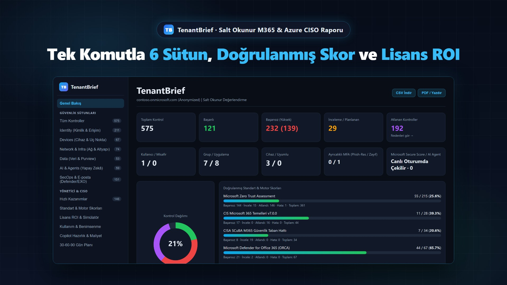
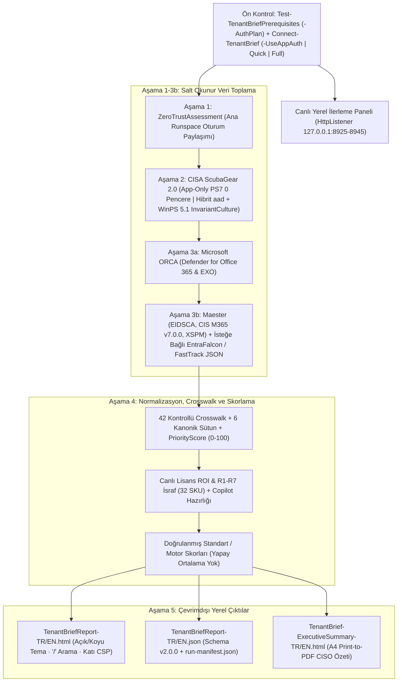

<div align="center">

# TenantBrief

**Salt okunur, sıfır telemetrili Microsoft 365 & Azure CISO güvenlik duruşu ve lisans ROI raporu (`TR / EN`)**

[](https://github.com/canercetinkaya/TenantBrief/actions/workflows/ci.yml)
[](https://github.com/canercetinkaya/TenantBrief/releases)
[](LICENSE)
[](https://learn.microsoft.com/powershell/)
[](tests/)

*`ZeroTrustAssessment`, `CISA ScubaGear 2.0`, `Microsoft ORCA`, `Maester` (`EIDSCA` / `CIS M365 v7.0.0` / `XSPM`) ve isteğe bağlı `EntraFalcon` çıktılarının tamamını tek yerel çalıştırmada **6 kanonik güvenlik sütununda**, **doğrulanmış standart skorlarıyla**, **32 SKU R1–R7 lisans israfı denetimiyle** ve **Copilot hazırlık analiziyle** birleştirir — kiracıda tek bir ayar bile değiştirmeden.*

<br/>

[](https://canercetinkaya.com/tr/blog/tenantbrief-m365-lisans-roi-uyumluluk-analizi#demo-video)

*▶ 20 saniyelik 1080p sesli demoyu indirmeden doğrudan tarayıcıda izlemek için yukarıdaki önizlemeye tıklayın (anonimleştirilmiş demo kiracısı).*

[📖 Türkçe Mimari İnceleme](https://canercetinkaya.com/tr/blog/tenantbrief-m365-lisans-roi-uyumluluk-analizi) · [🌐 English Deep Dive](https://canercetinkaya.com/en/blog/tenantbrief-m365-lisans-roi-uyumluluk-analizi) · [📊 Canlı Demo (TR)](demo/TenantBriefReport-TR.html) · [📊 Live Demo (EN)](demo/TenantBriefReport-EN.html) · [📄 CISO PDF Özeti (TR)](demo/TenantBrief-ExecutiveSummary-TR.html)

</div>

---

## Neden TenantBrief?

| Kurumsal Problem | TenantBrief Yaklaşımı |
| --- | --- |
| **Parçalı araç çıktıları ve mükerrer triyaj** | Tüm bulguları araç sekmelerine bölmek yerine **6 kanonik güvenlik sütununda** (`Identity`, `Devices`, `Network`, `Data`, `AI`, `SecOps`) toplar; **42 kontrollü crosswalk** ile çoklu kaynak etiketleri (`Sources`) ekler. |
| **Yapay uyumluluk yüzdeleri** | Şişirilmiş çerçeve ortalamaları üretmez; yalnızca gerçek test edilen standartların (`ZeroTrustAssessment`, `CIS M365 v7.0.0`, `CISA SCuBA`, `ORCA`, `EIDSCA`, `XSPM`, `EntraFalcon`) doğrulanmış skorlarını hesaplar. |
| **Atıl E3/E5/Copilot lisans maliyeti** | Canlı `/subscribedSkus` ve `/users` telemetrisiyle **32 SKU** üzerinde **R1–R7 lisans israfı**, 10 çakışma kuralı ve **L1–L4 Copilot hazırlık** analizi sunar. |
| **Çoklu kimlik doğrulama yorgunluğu** | `Initialize-TenantBriefApp` + `Connect-TenantBrief -UseAppAuth` ile **0 (sıfır) pencere tam kapsam**, veya varsayılan `-Profile Quick` ile **0–3 pencere** hızlı başlangıç sağlar. |
| **Veri gizliliği ve denetim güvenliği** | **%100 salt okunur**, sıfır telemetri, harici AI çağrısı yok, katı çevrimdışı CSP (`default-src 'none'`), HTML-escaped JSON, açık/koyu tema geçişli rapor ve `-Anonymize` maskeleme. |

---

## Hızlı Başlangıç

### 1. Sıfır Pencere, Tam %100 Otomasyon (Önerilen — Sertifika Tabanlı)

Tek seferlik kurulum yerel dışa aktarılamaz X.509 sertifikası, salt okunur Entra ID uygulama kaydı (37 salt okunur Graph izni + `Exchange.ManageAsApp` + `Global Reader`) oluşturur. Sonraki her tarama **0 pencereyle** tamamlanır:

```powershell
git clone https://github.com/canercetinkaya/TenantBrief.git
cd TenantBrief
Import-Module .\TenantBrief.psd1 -Force

# Tek seferlik kurulum (yalnızca 1 kez yönetici onayı ister)
Initialize-TenantBriefApp

# Sonrasında her seferinde 0 pencere, tam kapsam (ZeroTrust + ScubaGear + ORCA + Maester + Lisans ROI)
Connect-TenantBrief -UseAppAuth
Invoke-TenantBriefAssessment -OutputPath "$HOME\TenantBriefReport" -Language tr -Framework All

# İstediğinizde tam geri dönüş (Entra uygulamasını, yerel sertifikayı ve profili siler)
Initialize-TenantBriefApp -Remove
```

> Sertifika destek matrisi ve en az ayrıcalıklı izin listesi için: [docs/unattended-auth.md](docs/unattended-auth.md)

### 2. Hızlı Etkileşimli Başlangıç (`Quick` Varsayılan — 0–3 Pencere)

Kiracıda hiçbir uygulama kaydı açmadan (danışmanlık / tek seferlik değerlendirme) hızlıca rapor almak için:

```powershell
Import-Module .\TenantBrief.psd1 -Force

# Salt okunur ortam kontrolü ve kuru çalıştırma giriş planı (hiçbir oturum açmaz)
Test-TenantBriefPrerequisites
Test-TenantBriefPrerequisites -AuthPlan

# Yalnızca Graph + EXO + Security & Compliance bağlanır (UPN login hint ile; Azure için -IncludeAzure)
Connect-TenantBrief

# ZeroTrust + ScubaGear aad (0 ek pencere) + ORCA + Maester + Lisans ROI
Invoke-TenantBriefAssessment -OutputPath "$HOME\TenantBriefReport" -Language tr -Framework All
```

### 3. Tam Etkileşimli Kapsam (Teams + SharePoint + Çoklu ScubaGear)

```powershell
Connect-TenantBrief -Profile Full -IncludeAzure
Invoke-TenantBriefAssessment -OutputPath "$HOME\TenantBriefReport" -Language tr -Framework All -ScubaInteractiveLogin -ScubaProducts aad,securitysuite,exo,sharepoint,teams
```

---

## 5 Aşamalı Mimari



---

## Ön Koşullar ve Modül Güvenliği

TenantBrief **varsayılan olarak yerel PowerShell modüllerinizi asla kurmaz, güncellemez veya silmez.** Otomatik modül kurulumu yalnızca `-AutoFixDependencies` anahtarını açıkça verdiğinizde çalışır.

| Bileşen | Kullanım Amacı | Varsayılan (Salt Okunur) | `-AutoFixDependencies` ile |
| --- | --- | --- | --- |
| **PowerShell `7.6+`** | Canlı kiracı taramaları (`ZeroTrustAssessment v3.1.0`) | Manuel kurulum | Manuel kurulum |
| **PowerShell `7.0+`** | Çevrimdışı JSON analizi (`-InputReportJson`, `-Resume`) | Manuel kurulum | Manuel kurulum |
| **Windows PowerShell `5.1`** | Etkileşimli `-ScubaInteractiveLogin` non-AAD izolasyonu | Windows'ta yerleşik | Windows'ta yerleşik |
| **`ZeroTrustAssessment`** | Aşama 1 çekirdek güvenlik duruşu | Eksikse kurulum komutu verir | Otomatik kurar (`CurrentUser`) |
| **`ScubaGear` + `OPA` + `powershell-yaml`** | Aşama 2 CISA SCuBA taban hattı | Eksikse uyarır ve atlar | Otomatik kurar (`CurrentUser` + OPA) |
| **`ORCA` ve `Maester`** | Aşama 3a/3b MDO, EIDSCA, CIS M365 v7.0.0, XSPM | Eksikse uyarır ve atlar | Otomatik kurar (`CurrentUser`) |
| **`MicrosoftTeams` ve `SPO`** | `-Profile Full` Teams / SharePoint kontrolleri | Eksikse uyarır | Otomatik kurar |
| **M365 Rolü** | Salt okunur kiracı erişimi | **`Global Reader`** (önerilen) | Değişmez (yazma kapsamı istenmez) |

---

## Diğer Çalıştırma Modları ve Rapor Türleri

| Mod | Komut Örneği | Üretilen Çıktı |
| --- | --- | --- |
| **Giriş Planı (Kuru Çalıştırma)** | `Test-TenantBriefPrerequisites -AuthPlan` | Oturum açmadan bağlanılacak servisleri ve beklenen pencere sayısını gösterir |
| **Kaldığı Yerden Devam (`-Resume`)** | `Invoke-TenantBriefAssessment -Resume -OutputPath "$HOME\TenantBriefReport" -Language tr -NoBrowser` | Önceki Aşama 1–4 çıktılarını kullanarak saniyeler içinde raporu yeniden üretir |
| **Çevrimdışı / Air-Gapped Birleştirme** | `Invoke-TenantBriefAssessment -InputReportJson .\zt.json -InputScubaJsonPath .\raw-scuba -InputOrcaJsonPath .\orca.json -InputMaesterJsonPath .\maester.json -InputEntraFalconJsonPath .\ef.json -OutputPath .\out -Language tr` | Canlı kiracı bağlantısı olmadan tam rapor üretir (FastTrack Copilot, SharePoint Risk CSV ve Power Platform Agents JSON/CSV destekli) |
| **Paylaşılabilir Maskeli Rapor** | Herhangi bir komuta `-Anonymize` ekleyin | Kiracı adı, alan adı, GUID ve UPN bilgilerini HTML, JSON ve PDF özetinde maskeler |
| **Yalnızca Yönetici PDF Özeti** | `Export-TenantBriefExecutiveSummary -InputJsonPath .\TenantBriefReport-TR.json -OutputHtmlPath .\ozet.html -Language tr` | Düşük efor / yüksek risk sırasına göre kompakt A4 Print-to-PDF CISO özeti |
| **Tarihsel Trend / Sapma Analizi** | `Compare-TenantBriefReports -BaselineJsonPath .\onceki.json -CurrentJsonPath .\yeni.json` | İyileşen (`Improved`) ve gerileyen (`Regressed`) kontrol farklarını çıkarır (`v1.x -> v2.0.0` uyumlu; bkz. [docs/migration-v1-to-v2.md](docs/migration-v1-to-v2.md)) |
| **Bağımsız ROI / Copilot / Kullanım** | `Get-TenantBriefLicenseRoi`, `Get-TenantBriefLicenseWaste`, `Get-TenantBriefCopilotReadiness`, `Get-TenantBriefUsageAdoption` | CSV/Excel veya özel otomasyonlar için yapılandırılmış PowerShell nesneleri |

---

## Güvenlik, Gizlilik ve Bakım

- **Sertleştirilmiş Çevrimdışı Çıktılar:** Katı `Content-Security-Policy` (`default-src 'none'; connect-src 'none'`), HTML-escaped JSON yükleri, headless Chromium XSS CI kontrolleri ve `-Anonymize` maskeleme. Ayrıntılar: [SECURITY.md](SECURITY.md).
- **Açık Kaynak Ekosistem Atıfları:** Microsoft `ZeroTrustAssessment`, CISA `ScubaGear`, Microsoft `ORCA`, `Maester` (`EIDSCA` / `CIS M365`), isteğe bağlı `EntraFalcon` ve Microsoft FastTrack araçları üzerine inşa edilmiştir. Tam atıflar: [NOTICE.md](NOTICE.md).
- **Aylık Salt Okunur Yukarı Akış Sürüm Denetimi:** Sabitlenen sürümler `data/upstream-versions.json` içindedir (`Save-Module` + `%TEMP%` üzerinde izole `git worktree`, yerel modüllere dokunmaz):
  ```powershell
  pwsh -NoProfile -File .\tools\Register-TenantBriefUpstreamCheck.ps1          # aylık kontrolü kur (-Unregister kaldırır)
  pwsh -NoProfile -File .\tools\Invoke-TenantBriefUpstreamCheck.ps1 -DryRun   # manuel kuru çalıştırma
  ```
- **Kalite Kapıları:** `Invoke-Pester ./tests` (**136/136 PASS**), `PSScriptAnalyzer 1.25.0` CI sınırı (`<= 82`, `0 Error`), `PriorityScore` ağırlıkları (`data/scoring.json`), `tools/Measure-TenantBriefQuality.ps1` (`Q01–Q15`) ve JSON Schema v2.0.0 (`schemas/tenantbrief-report.schema.json`).
- **Lisans ve Tasarım:** MIT ([LICENSE](LICENSE)) · Arayüz tasarım iyileştirmesi: [unslop](https://github.com/heydamir/unslop) — Damir Sokolovsky (CC BY 4.0) · Mimari notlar: [canercetinkaya.com](https://canercetinkaya.com/tr/blog/tenantbrief-m365-lisans-roi-uyumluluk-analizi)
