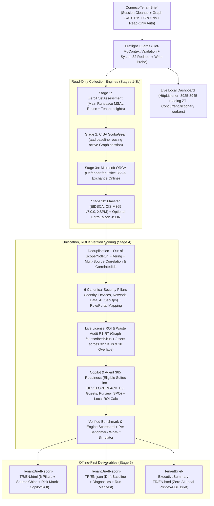

# TenantBrief

**TenantBrief** is an open-source, strictly **read-only**, bilingual (**Turkish / English**) Microsoft 365 & Azure security posture, **License ROI**, and **verified benchmark scoring** platform. It orchestrates `ZeroTrustAssessment`, `CISA ScubaGear`, `Microsoft ORCA`, `Maester` (`EIDSCA` / `CIS M365` / `XSPM`), and optional `EntraFalcon` exports, unifies every finding into **6 canonical security pillars** with **multi-source tags**, and removes synthetic framework guesses in favor of **verifiable benchmark scores**.

> **Why TenantBrief?**
> Raw security scanner exports dump hundreds of engine-specific tabs, duplicate controls, and unverified checklists. TenantBrief answers three CISO-level questions clearly without sending tenant data to external AI:
> 1. **Unified 6 Security Pillars + Multi-Source Provenance:** Instead of splitting the UI by scanner tool names, all controls are organized under **Identity**, **Devices**, **Network & Infra**, **Data**, **AI & Agents**, and **SecOps & Email** — while preserving multi-source badges (`ZeroTrust`, `CISA SCuBA`, `MDO / ORCA`, `CIS M365`, `EIDSCA`, `Maester`, `EntraFalcon`) and filter chips.
> 2. **Verifiable Benchmark Scores (Zero Synthetic Averages):** TenantBrief does **not** fabricate ISO/NIST/KVKK compliance percentages from coarse pillar averages. Every score bar strictly reflects controls actually tested by that benchmark/engine (`Microsoft ZeroTrustAssessment`, `CIS Microsoft 365 Foundations v7.0.0`, `CISA SCuBA Baseline`, `Microsoft Defender for Office 365 (ORCA)`, `EIDSCA`, `Maester M365 & XSPM`, and optional `EntraFalcon`).
> 3. **Real License ROI, Waste Audit (R1–R7) & Copilot Readiness:** Combines live Graph `/v1.0/subscribedSkus` and `/v1.0/users` telemetry across **32 SKUs** and **10 overlap rules** with L1–L4 Copilot readiness checks and a local Print-to-PDF executive brief.

---

## Architecture & 5-Stage Execution Pipeline

`Invoke-TenantBriefAssessment` executes `ZeroTrustAssessment` in the **main PowerShell runspace** (reusing active MSAL, Microsoft Graph, Azure, Exchange Online, and SharePoint sessions) while streaming live progress to a local dashboard on `http://localhost:8925–8945/`:



---

## Key Capabilities

- **6 Canonical Security Pillars & Multi-Source Provenance:** Maps controls from all integrated tools into **Identity**, **Devices**, **Network**, **Data**, **AI**, and **SecOps** (`DomainPillars`), attaches multi-engine provenance badges (`Sources` and `CorrelatedIds`), and enriches actionable rows with control-specific least-privilege `RequiredRole` and `AdminPortal` metadata.
- **Strictly Verifiable Benchmark Scoring:** Evaluates each integrated benchmark (`ZeroTrust`, `CIS_M365`, `CISA_SCuBA`, `MDO_ORCA`, `EIDSCA`, `Maester`, `EntraFalcon`) strictly against controls carrying its own `SourceTag` in `data/framework-mappings.json`. Only benchmarks present in the run are scored in `-Framework All`, and `Status: Error` stays in the denominator so unmeasured controls never inflate scores.
- **Clean Signal Filtering (Zero Inflation):** Automatically excludes unexecuted Pester `-ExcludeTag` entries (`Result: NotRun`), out-of-scope suites (`AD.*`, `AZDO.*`, `CIS.GH.*`), duplicate `CISA`/`ORCA` wrappers inside Maester, and normalizes Pester 6 `PesterTestSkipped` records from false `Error` states back into explicit `Skipped` entries with readable permission reasons.
- **Multi-Pillar Control Preservation:** Splits combined pillars such as `Data AI`, `AI SecOps`, and `Network AI` into array tags so every AI/Data/Network finding contributes accurately to all relevant domain views and benchmark refs.
- **Strictly Read-Only & Diagnosable (`run-manifest.json` + `-Resume`):** Never writes to tenant policies or calls `Disconnect-MgGraph` mid-session. Writes every stage transition and sub-analysis failure to `run-manifest.json` and `Diagnostics`, caches Stage 4 live telemetry for offline `-Resume` runs, and completes interrupted scans cleanly with `Invoke-TenantBriefAssessment -Resume`.
- **Live License ROI, Waste Audit (`R1–R7`) & Copilot Readiness (`Get-TenantBriefCopilotReadiness`):** Evaluates `/v1.0/subscribedSkus` and paginated `/v1.0/users` across **32 SKUs** and **10 overlap rules**, checks eligible Copilot base suites (`E3/E5/F1/F3/Business/DEVELOPERPACK_E5/EDU`), Entra guest boundaries, Purview sensitivity labels, OAuth user consent (`COP-APP-01`), and SharePoint `Get-SPOTenant` / Graph `/admin/sharepoint/settings` oversharing controls—plus a browser-local Copilot & Agent Studio ROI calculator.

---

## Exported Cmdlets

| Cmdlet | Purpose |
| --- | --- |
| `Connect-TenantBrief` | Clears stale sessions, ensures pinned dependencies (`Graph v2.40.0`, `SPO v16.0.27612.12000`, `ScubaGear`, `ORCA`, `Maester`), and connects read-only to Graph/Azure/EXO/SCC |
| `Invoke-TenantBriefAssessment` | Orchestrates Stages 1–5 live or offline (`-InputReportJson`, `-Resume`, `-InputFastTrackJsonPath`, `-InputMaesterJsonPath`, `-InputEntraFalconJsonPath`, `-SkipMaester`) and outputs HTML, JSON, Executive Summary, and `run-manifest.json` |
| `Get-TenantBriefFrameworks` | Lists the 7 verified benchmarks & engines defined in `data/framework-mappings.json` (`SourceTag` + upstream repo URL) |
| `Get-TenantBriefLicenseRoi` | Computes purchased, assigned, and idle USD/month estimates across 32 Microsoft SKUs from `/v1.0/subscribedSkus` |
| `Get-TenantBriefLicenseWaste` | Audits disabled licensed users (`R1`), 90+ day inactive users (`R2`), unassigned billable seats (`R3`), overlapping SKUs (`R4`), and licensed guests (`R7`) |
| `Get-TenantBriefCopilotReadiness` | Evaluates M365 Copilot & Agent 365 readiness, security warnings, and L1–L4 maturity live or via FastTrack JSON |
| `Compare-TenantBriefReports` | Compares two `TenantBriefReport-*.json` snapshots to detect `Improved` and `Regressed` controls |
| `Export-TenantBriefExecutiveSummary` | Generates a compact, offline Print-to-PDF executive brief ordered by lowest-effort high-risk remediations first |

---

## Prerequisites

- **Live Tenant Assessment:** **PowerShell 7.6+** (`ZeroTrustAssessment v3.1.0` requires PowerShell 7.6+; tested on PowerShell 7.7)
- **Offline JSON Analysis / `-Resume`:** **PowerShell 7.0+** (`pwsh`)
- **Modules:** `ZeroTrustAssessment` (`Install-Module ZeroTrustAssessment -Scope CurrentUser`); `ScubaGear`, `OPA`, `powershell-yaml`, `ORCA`, and `Maester` are validated/installed as needed
- **Minimum Read-Only Roles:** `Global Reader` (recommended for complete Entra, Defender, EXO, Purview, and SharePoint coverage) or `Security Reader` + `Reports Reader`

---

## Quick Start

### 1. Clone & Import

```powershell
git clone https://github.com/canercetinkaya/TenantBrief.git
cd TenantBrief
Import-Module .\TenantBrief.psd1 -Force
```

### 2. List Verified Benchmarks & Engines

```powershell
Get-TenantBriefFrameworks | Format-Table Id, NameTr, SourceTag
```

### 3. Run Live Tenant Assessment (Read-Only)

```powershell
# Authenticate cleanly in read-only mode
Connect-TenantBrief

# Execute Stages 1-5 with live dashboard (:8925-8945) and TR/EN deliverables
Invoke-TenantBriefAssessment -OutputPath "$HOME\TenantBriefReport" -Language tr -Framework All
```

### 4. Resume an Interrupted Run or Score a Single Benchmark Offline

```powershell
# Finish an existing run folder using cached Stage 1-3 outputs without re-scanning the tenant
Invoke-TenantBriefAssessment -Resume -OutputPath "$HOME\TenantBriefReport" -Language tr -NoBrowser

# Score only CISA SCuBA from an offline export (anonymized)
Invoke-TenantBriefAssessment `
  -InputReportJson .\ZeroTrustAssessmentReport.json `
  -OutputPath .\demo `
  -Language en `
  -Framework CISA_SCuBA `
  -Anonymize `
  -NoBrowser
```

### 5. Standalone License ROI, Waste (`R1–R7`), Copilot Readiness & Drift Checks

```powershell
Get-TenantBriefLicenseRoi | Format-Table ProductName, Purchased, Assigned, Unassigned, UtilizationPercent, EstimatedIdleUsdMo
Get-TenantBriefLicenseWaste | Format-List
Get-TenantBriefCopilotReadiness -Language tr
Compare-TenantBriefReports -BaselineJsonPath .\prev\TenantBriefReport-TR.json -CurrentJsonPath .\curr\TenantBriefReport-TR.json
```

---

## Demo Reports

Anonymized bilingual sample reports (reflecting the 6-pillar architecture, multi-source filters, verified benchmark scores, License ROI & R1–R7 waste audit, and Copilot readiness) are included in `demo/`:

- [demo/TenantBriefReport-TR.html](demo/TenantBriefReport-TR.html) (Turkish Interactive Report)
- [demo/TenantBriefReport-EN.html](demo/TenantBriefReport-EN.html) (English Interactive Report)
- [demo/TenantBrief-ExecutiveSummary-TR.html](demo/TenantBrief-ExecutiveSummary-TR.html) (Turkish Print-to-PDF Executive Brief)
- [demo/TenantBrief-ExecutiveSummary-EN.html](demo/TenantBrief-ExecutiveSummary-EN.html) (English Print-to-PDF Executive Brief)

---

## Upstream Open-Source Ecosystem & Acknowledgements

TenantBrief stands on top of trusted Microsoft and community open-source security projects. Full attribution details live in [NOTICE.md](NOTICE.md):

| Project | Repository | Integration Mode in TenantBrief |
| --- | --- | --- |
| **Microsoft ZeroTrustAssessment** | [microsoft/zerotrustassessment](https://github.com/microsoft/zerotrustassessment) | Stage 1 core assessment (`Invoke-ZtAssessment`) & live worker telemetry |
| **CISA ScubaGear** | [cisagov/ScubaGear](https://github.com/cisagov/ScubaGear) | Stage 2 SCuBA `aad` security baseline (`Invoke-SCuBA`) |
| **Microsoft ORCA** | [martin9700/ORCA](https://github.com/martin9700/ORCA) | Stage 3a Defender for Office 365 & EXO checks (`Invoke-ORCA`) |
| **Maester (EIDSCA & CIS M365)** | [maester365/maester](https://github.com/maester365/maester) | Stage 3b automated `EIDSCA`, `CIS M365 v7.0.0`, and `XSPM` checks (`Invoke-Maester` / `-InputMaesterJsonPath`) |
| **EntraFalcon** | [CompassSecurity/EntraFalcon](https://github.com/CompassSecurity/EntraFalcon) | Optional offline Entra privilege & attack-path JSON ingestion (`-InputEntraFalconJsonPath`) |
| **Microsoft FastTrack** | [microsoft/FastTrack](https://microsoft.github.io/FastTrack/#get-m365copilotreadiness) | Copilot eligibility, SharePoint RAC/RCD model & `-InputFastTrackJsonPath` schema |
| **M365 Copilot Automated Readiness** | [microsoft/m365-copilot-automated-readiness-assessment](https://github.com/microsoft/m365-copilot-automated-readiness-assessment) | Graph readiness signal checks adapted without mid-session disconnects |
| **M365 License Review** | [samuelgtetteh/m365-license-review](https://github.com/samuelgtetteh/m365-license-review) | R1–R7 license waste and duplicate SKU overlap audit methodology |
| **Copilot ROI Calculator** | [amitlals/copilot-roi-calculator](https://github.com/amitlals/copilot-roi-calculator) | Browser-local Copilot & Agent Studio ROI calculation model |

---

## Security & Privacy Guarantees

- **Zero Telemetry & Zero External AI Exposure:** `TenantBrief` sends no telemetry and never forwards tenant findings, user UPNs, or SKU inventories to any external LLM/AI endpoint.
- **Strict Read-Only Surface:** Executes only read-only Graph GET endpoints and read-only PowerShell assessment cmdlets.
- **Anonymization (`-Anonymize`):** Masks primary tenant domains before generating shareable reports.

---

## Development & Tests

```powershell
Install-Module Pester -Scope CurrentUser -MinimumVersion 5.0 -Force   # once
Invoke-Pester ./tests -Output Detailed
```

| Path | Scope |
| --- | --- |
| `tests/TenantBrief.Tests.ps1` | Unit tests: exports, 7 verified benchmarks, License ROI/waste, Graph paging, Copilot readiness (`DEVELOPERPACK_E5` & `COP-APP-01`), Maester filtering (`NotRun`/`AD`/`AZDO`/`PesterTestSkipped`), multi-pillar split, role/portal mapping |
| `tests/TenantBrief.Pipeline.Tests.ps1` | End-to-end offline pipeline, `-Resume`, `Diagnostics`, `DomainPillar`/`Sources`/`CorrelatedIds`, verified `SourceTag` scoring, report comparison, executive brief prioritization |
| `tests/fixtures/ZeroTrustAssessmentReport.sample.json` | Anonymized offline fixture used by automated CI (`.github/workflows/ci.yml`) |

---

## Technical Article & License

- **Technical Deep-Dive (TR):** [TenantBrief: Salt Okunur M365 Lisans İsrafı, Copilot Hazırlığı ve Doğrulanmış Standart Skorlama Mimarisi](https://canercetinkaya.com/tr/blog/tenantbrief-m365-lisans-roi-uyumluluk-analizi)
- **Technical Deep-Dive (EN):** [TenantBrief: Read-Only M365 License Waste, Copilot Readiness, and Verified Benchmark Scoring](https://canercetinkaya.com/en/blog/tenantbrief-m365-lisans-roi-uyumluluk-analizi)
- **License & Notices:** MIT License ([LICENSE](LICENSE)) · Third-party attributions ([NOTICE.md](NOTICE.md))
