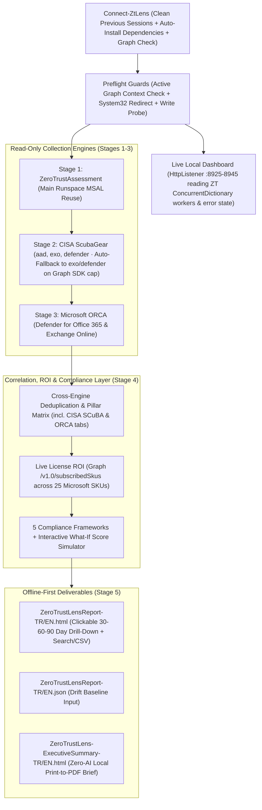

# ZeroTrustLens

**ZeroTrustLens** is a strictly **read-only**, bilingual (**Turkish / English**) Microsoft 365 & Azure security posture, **License ROI**, and **multi-framework compliance** assessment platform built around Microsoft's `ZeroTrustAssessment`, `CISA ScubaGear`, and `Microsoft ORCA`.

> **Why ZeroTrustLens?**
> Raw technical assessment exports list hundreds of `Passed / Failed` checks, leaving CISOs, security architects, and IT directors with three unanswered questions:
> 1. **Real License ROI & Blind Spots:** How much of our purchased Microsoft 365 E3/E5, Defender, Purview, and Copilot licensing is actually assigned vs. sitting idle (`USD/month` and `USD/year`), and which features are `Skipped` due to missing configuration?
> 2. **Multi-Framework Alignment:** How do M365, Entra ID, CISA SCuBA baselines, and Defender for Office 365 controls map simultaneously to **Microsoft Zero Trust**, **ISO/IEC 27001:2022**, **NIST CSF 2.0**, **CIS Microsoft 365 Foundations**, and **KVKK Technical Measures (TR)**?
> 3. **Zero-Telemetry Executive Action Plan:** Which high-risk findings fit into an interactive **0–30 / 31–60 / 61–90 day** roadmap, and can leadership export a Print-to-PDF brief without sending any tenant data to external AI services?

---

## Architecture & 5-Stage Execution Pipeline

`Invoke-ZtLensAssessment` runs `ZeroTrustAssessment` in the **main PowerShell runspace** (inheriting your authenticated MSAL/Graph, Azure, Exchange Online, and Security & Compliance tokens without re-prompting) while serving a local, real-time step-by-step dashboard on `http://localhost:8925–8945/`:



---

## Key Capabilities

- **Strictly Read-Only & Fail-Fast Auth Guard:** Never modifies tenant policies, Conditional Access rules, or Entra ID objects. Both `Connect-ZtLens` and `Invoke-ZtLensAssessment` verify `Get-MgContext` up front and abort immediately if authentication is missing or canceled (without creating empty run folders or leaving a stuck progress UI).
- **Live Step-by-Step Browser Dashboard (`localhost:8925–8945`):** Directly reads `ZeroTrustAssessment`'s thread-safe `ProgressState` concurrent worker dictionary (`Running`, `Failed`, `Done`, phase counts, active detail, elapsed time) and surfaces PowerShell errors or disconnects immediately.
- **Cross-Engine Correlation (`ZeroTrustAssessment` + `CISA ScubaGear` + `ORCA`):** Automatically installs missing dependencies (`powershell-yaml`, `OPA`, `ScubaGear`, `ORCA`), deduplicates overlapping controls, retries ScubaGear for `exo, defender` if local `Microsoft.Graph.Authentication` exceeds ScubaGear's max module cap (`2.25.0`), and surfaces dedicated `CISA SCuBA` and `MDO / ORCA` sidebar views & risk matrix rows.
- **Live Tenant License ROI (`Get-ZtLensLicenseRoi`):** Queries Microsoft Graph `/v1.0/subscribedSkus` in read-only mode to embed actual purchased vs. assigned vs. unassigned seat counts and monthly/annual idle spend across 25 Microsoft 365, Entra ID, Defender, Intune, Purview, and Copilot SKUs.
- **5 Selectable Compliance Frameworks:** Maps controls across `ZeroTrust`, `ISO27001`, `NIST_CSF_2`, `CIS_M365`, and `KVKK_TR` (including `CISA SCuBA` and `Defender for Office 365 (ORCA)` mappings in every framework).
- **Interactive 30-60-90 Day Roadmap & What-If Simulator:** Click any 0–30, 31–60, or 61–90 day bucket in the HTML report to filter concrete remediation controls, or simulate closing high-risk/skipped gaps in real time.
- **Zero-AI Local Executive Summary (`Export-ZtLensExecutiveSummary`) & Drift Diff (`Compare-ZtLensReports`):** Generates a Print-to-PDF executive table of top priority remediations completely offline with zero external LLM data exposure, and compares two JSON baselines over time to track improved vs. regressed controls.
- **System-Protected Folder Safeguard & Multi-Tenant Isolation:** Automatically redirects default/protected paths under `Windows\System32` to `$HOME\ZeroTrustLensReport`, isolates live runs into `<OutputPath>\<Tenant>_<yyyyMMdd_HHmm>`, and supports `-Anonymize` to strip tenant identifiers.

---

## Exported Cmdlets

| Cmdlet | Purpose |
| --- | --- |
| `Connect-ZtLens` | Clears prior sessions, ensures dependencies, connects read-only to Graph/Azure/EXO/SCC, and verifies active context |
| `Invoke-ZtLensAssessment` | Orchestrates Stages 1–5 live or offline (`-InputReportJson`) and outputs HTML, JSON, and Executive Summary reports |
| `Get-ZtLensFrameworks` | Lists the 5 supported compliance frameworks and their TR/EN descriptions |
| `Get-ZtLensLicenseRoi` | Computes seat utilization and monthly idle USD estimate across 25 SKUs from `/v1.0/subscribedSkus` |
| `Compare-ZtLensReports` | Compares a baseline and current `ZeroTrustLensReport-*.json` to list `Improved` and `Regressed` controls |
| `Export-ZtLensExecutiveSummary` | Generates a compact, offline Print-to-PDF executive brief from any `ZeroTrustLensReport-*.json` |

---

## Prerequisites

- **Live Tenant Assessment:** **PowerShell 7.6+** (`ZeroTrustAssessment v3.1.0` requires PowerShell 7.6+; tested on PowerShell 7.7)
- **Offline JSON Analysis (`-InputReportJson`):** **PowerShell 7.0+** (`pwsh`)
- **Required Module:** `ZeroTrustAssessment` (`Install-Module ZeroTrustAssessment -Scope CurrentUser`); `ScubaGear`, `OPA`, `powershell-yaml`, and `ORCA` are checked/installed automatically by `Connect-ZtLens` / `Invoke-ZtLensAssessment`
- **Minimum Read-Only Roles:** `Global Reader` (recommended for full M365 + Defender + Compliance coverage) or `Security Reader` + `Reports Reader`

---

## Quick Start

### 1. Clone & Import

```powershell
git clone https://github.com/canercetinkaya/ZeroTrustLens.git
cd ZeroTrustLens
Import-Module .\ZeroTrustLens.psd1 -Force
```

### 2. List Supported Frameworks

```powershell
Get-ZtLensFrameworks
```

### 3. Run Live Tenant Assessment (Read-Only)

```powershell
# Authenticate cleanly (auto-installs missing ScubaGear/OPA/ORCA dependencies)
Connect-ZtLens

# Run live assessment with real-time step dashboard & TR HTML/JSON/PDF Executive outputs
Invoke-ZtLensAssessment -OutputPath "$HOME\ZeroTrustLensReport" -Language tr -Framework All
```

### 4. Inspect License ROI & Historical Drift

```powershell
# Standalone License ROI query against active Graph session
Get-ZtLensLicenseRoi | Format-Table ProductName, Purchased, Assigned, Unassigned, UtilizationPercent, EstimatedIdleUsdMo

# Compare two historical JSON exports
Compare-ZtLensReports -BaselineJsonPath .\prev\ZeroTrustLensReport-TR.json -CurrentJsonPath .\curr\ZeroTrustLensReport-TR.json
```

### 5. Analyze an Existing `ZeroTrustAssessmentReport.json` Offline

```powershell
# Generate an anonymized English report from an existing export without tenant connectivity
Invoke-ZtLensAssessment `
  -InputReportJson .\ZeroTrustAssessmentReport.json `
  -OutputPath .\demo `
  -Language en `
  -Anonymize `
  -NoBrowser
```

---

## Demo Reports

Anonymized sample reports generated from an actual tenant export (showing the interactive dashboard, 5 frameworks, 30-60-90 day roadmap drill-down, What-If simulator, and offline Executive Summary) are included in `demo/`:

- [demo/ZeroTrustLensReport-TR.html](demo/ZeroTrustLensReport-TR.html) (Turkish Interactive Report)
- [demo/ZeroTrustLensReport-EN.html](demo/ZeroTrustLensReport-EN.html) (English Interactive Report)
- [demo/ZeroTrustLens-ExecutiveSummary-TR.html](demo/ZeroTrustLens-ExecutiveSummary-TR.html) (Turkish Print-to-PDF Executive Brief)
- [demo/ZeroTrustLens-ExecutiveSummary-EN.html](demo/ZeroTrustLens-ExecutiveSummary-EN.html) (English Print-to-PDF Executive Brief)

---

## Security & Privacy

- **Zero Telemetry & Zero External AI Exposure:** `ZeroTrustLens` sends no telemetry and never forwards tenant findings or SKU counts to any external LLM/AI service.
- **Strict Read-Only Surface:** Relies solely on read-only assessment APIs (`GET /v1.0/subscribedSkus`, `ZeroTrustAssessment`, read-only `ScubaGear`/`ORCA` inspection).
- **Anonymization (`-Anonymize`):** Masks tenant domain identifiers before sharing reports externally.

---

## Technical Article & License

- **Technical Deep-Dive (TR):** [ZeroTrustLens: Microsoft 365 Lisans ROI ve Çoklu Çerçeve Analizi](https://canercetinkaya.com/tr/blog/zerotrustlens-m365-lisans-roi-uyumluluk-analizi)
- **Technical Deep-Dive (EN):** [ZeroTrustLens: Read-Only M365 License ROI & Multi-Framework Analysis](https://canercetinkaya.com/en/blog/zerotrustlens-m365-lisans-roi-uyumluluk-analizi)
- **License:** MIT License — see [LICENSE](LICENSE).
