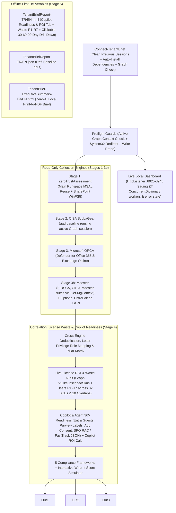

# TenantBrief

**TenantBrief** is a strictly **read-only**, bilingual (**Turkish / English**) Microsoft 365 & Azure security posture, **License ROI**, and **multi-framework compliance** assessment platform unifying Microsoft's `ZeroTrustAssessment`, `CISA ScubaGear`, `Microsoft ORCA`, `Maester` (`EIDSCA` / `CIS` / `XSPM`), and optional `EntraFalcon` attack-path JSON ingestion.

> **Why TenantBrief?**
> Raw technical assessment exports list hundreds of `Passed / Failed` checks, leaving CISOs, security architects, and IT directors with three unanswered questions:
> 1. **Real License ROI & Blind Spots:** How much of our purchased Microsoft 365 E3/E5, Defender, Purview, and Copilot licensing is actually assigned vs. sitting idle (`USD/month` and `USD/year`), and which features are `Skipped` due to missing configuration?
> 2. **Multi-Framework Alignment:** How do M365, Entra ID, CISA SCuBA baselines, and Defender for Office 365 controls map simultaneously to **Microsoft Zero Trust**, **ISO/IEC 27001:2022**, **NIST CSF 2.0**, **CIS Microsoft 365 Foundations**, and **KVKK Technical Measures (TR)**?
> 3. **Zero-Telemetry Executive Action Plan:** Which high-risk findings fit into an interactive **0–30 / 31–60 / 61–90 day** roadmap, and can leadership export a Print-to-PDF brief without sending any tenant data to external AI services?

---

## Architecture & 5-Stage Execution Pipeline

`Invoke-TenantBriefAssessment` runs `ZeroTrustAssessment` in the **main PowerShell runspace** (inheriting your authenticated MSAL/Graph, Azure, Exchange Online, and Security & Compliance tokens without re-prompting) while serving a local, real-time step-by-step dashboard on `http://localhost:8925–8945/`:



---

## Key Capabilities

- **Strictly Read-Only & Fail-Fast Auth Guard:** Never modifies tenant policies, Conditional Access rules, or Entra ID objects (nor calls `Disconnect-MgGraph` mid-session). Both `Connect-TenantBrief` and `Invoke-TenantBriefAssessment` validate `Get-MgContext` up front and abort cleanly if authentication is canceled.
- **Diagnosable Runs (no silent gaps):** Every stage transition is written to `run-manifest.json` next to the report, so an interrupted scan leaves an explicit trace instead of an empty folder. Failed sub-analyses (license waste, Copilot readiness, ScubaGear, ORCA) are recorded in the report's `Diagnostics` array and surfaced as a banner in the HTML and the executive brief — a missing section can no longer be mistaken for "no findings".
- **Resumable (`-Resume`):** If a run dies after Stage 1, `Invoke-TenantBriefAssessment -Resume -OutputPath <folder>` reuses the existing `ZeroTrustAssessmentReport.json` and finishes the report without rescanning the tenant.
- **Live Step-by-Step Browser Dashboard (`localhost:8925–8945`):** Directly reads `ZeroTrustAssessment`'s thread-safe `ProgressState` concurrent worker dictionary (`Running`, `Failed`, `Done`, phase counts, elapsed time) and surfaces PowerShell errors or disconnects immediately.
- **Cross-Engine Correlation (`ZeroTrustAssessment` + `CISA ScubaGear` + `ORCA` + `Maester` + `EntraFalcon`):** Automatically ensures pinned `Microsoft.Online.SharePoint.PowerShell v16.0.27612.12000`, `powershell-yaml`, `OPA`, `ScubaGear`, `ORCA`, and `Maester`, runs `Maester` (`EIDSCA`, `CIS`, `Maester`, `XSPM`) reusing the active Graph session, supports ingesting external `-InputMaesterJsonPath` and `EntraFalcon` `-InputEntraFalconJsonPath` (`tenant_findings_all_*.json`) exports, and maps least-privilege `RequiredRole` & `AdminPortal` metadata to every actionable finding.
- **Copilot & Agent 365 Readiness (`Get-TenantBriefCopilotReadiness`):** Integrates live Graph API readiness signals modeled on Microsoft FastTrack `Get-M365CopilotReadiness` & Microsoft `m365-copilot-automated-readiness-assessment` — checking eligible base suites, active Copilot seats, Entra guest invitation/role boundaries, Purview sensitivity labels, user OAuth app/plugin consent, and optional FastTrack `-InputFastTrackJsonPath` or live SharePoint RAC/Restricted Search checks with explicit L1–L4 maturity scoring and security warnings.
- **Live License ROI & Waste Hygiene (`Get-TenantBriefLicenseRoi` + `Get-TenantBriefLicenseWaste`):** Queries Graph `/v1.0/subscribedSkus` and `/v1.0/users` (inspired by `m365-license-review`) across **32 Microsoft SKUs** and **10 overlap rules** to detect unassigned seats, disabled licensed accounts (R1), 90+ day inactive licensed users (R2 when `AuditLog.Read.All` is granted), duplicate/overlapping SKUs such as `E5 + E3` / `E3 + EXO Plan 1` (R4), and licensed guests (R7).
- **Offline Interactive Copilot & Agent Studio ROI Calculator:** Inspired by `copilot-roi-calculator`, runs 100% locally inside the HTML report (`$30/user/mo` Copilot + `$200/tenant/mo` Studio + `$0.008/msg` PAYG, department presets, breakeven days, net annual ROI %, and **self-funded share from reclaimed M365 license waste**).
- **5 Selectable Compliance Frameworks & Zero-AI Print-to-PDF Brief:** Maps controls across `ZeroTrust`, `ISO27001`, `NIST_CSF_2`, `CIS_M365`, and `KVKK_TR`, generates an interactive 30-60-90 day drill-down + What-If simulator, and exports an offline executive PDF brief (`Compare-TenantBriefReports` + `Export-TenantBriefExecutiveSummary`).

---

## Exported Cmdlets

| Cmdlet | Purpose |
| --- | --- |
| `Connect-TenantBrief` | Clears prior sessions, ensures dependencies, connects read-only to Graph/Azure/EXO/SCC, and verifies active context |
| `Invoke-TenantBriefAssessment` | Orchestrates Stages 1–5 live or offline (`-InputReportJson`, `-InputFastTrackJsonPath`, `-InputMaesterJsonPath`, `-InputEntraFalconJsonPath`, `-SkipMaester`) and outputs HTML, JSON, and Executive Summary |
| `Get-TenantBriefFrameworks` | Lists the 5 supported compliance frameworks and their TR/EN descriptions |
| `Get-TenantBriefLicenseRoi` | Computes seat utilization and monthly idle USD estimate across 32 SKUs from `/v1.0/subscribedSkus` |
| `Get-TenantBriefLicenseWaste` | Evaluates disabled users (R1), 90d inactive users (R2), unassigned seats (R3), overlapping SKUs (R4), and licensed guests (R7) |
| `Get-TenantBriefCopilotReadiness` | Evaluates M365 Copilot & Agent 365 readiness, security warnings, and L1–L4 maturity score live or via FastTrack JSON |
| `Compare-TenantBriefReports` | Compares a baseline and current `TenantBriefReport-*.json` to list `Improved` and `Regressed` controls |
| `Export-TenantBriefExecutiveSummary` | Generates a compact, offline Print-to-PDF executive brief from any `TenantBriefReport-*.json` |

> Legacy `*-ZtLens*` cmdlet names (`Connect-ZtLens`, `Invoke-ZtLensAssessment`, etc.) remain exported as aliases for backward compatibility.

---

## Prerequisites

- **Live Tenant Assessment:** **PowerShell 7.6+** (`ZeroTrustAssessment v3.1.0` requires PowerShell 7.6+; tested on PowerShell 7.7)
- **Offline JSON Analysis (`-InputReportJson`):** **PowerShell 7.0+** (`pwsh`)
- **Required Module:** `ZeroTrustAssessment` (`Install-Module ZeroTrustAssessment -Scope CurrentUser`); `ScubaGear`, `OPA`, `powershell-yaml`, and `ORCA` are checked/installed automatically by `Connect-TenantBrief` / `Invoke-TenantBriefAssessment`
- **Minimum Read-Only Roles:** `Global Reader` (recommended for full M365 + Defender + Compliance coverage) or `Security Reader` + `Reports Reader`

---

## Quick Start

### 1. Clone & Import

```powershell
git clone https://github.com/canercetinkaya/TenantBrief.git
cd TenantBrief
Import-Module .\TenantBrief.psd1 -Force
```

### 2. List Supported Frameworks

```powershell
Get-TenantBriefFrameworks
```

### 3. Run Live Tenant Assessment (Read-Only)

```powershell
# Authenticate cleanly (auto-installs missing ScubaGear/OPA/ORCA dependencies)
Connect-TenantBrief

# Run live assessment with real-time step dashboard & TR HTML/JSON/PDF Executive outputs
Invoke-TenantBriefAssessment -OutputPath "$HOME\TenantBriefReport" -Language tr -Framework All
```

### 4. Inspect License ROI, License Waste (R1–R7), Copilot Readiness & Historical Drift

```powershell
# Standalone License ROI query across 32 Microsoft SKUs
Get-TenantBriefLicenseRoi | Format-Table ProductName, Purchased, Assigned, Unassigned, UtilizationPercent, EstimatedIdleUsdMo

# Audit disabled licensed users, 90d inactive accounts, licensed guests, and redundant SKU overlaps
Get-TenantBriefLicenseWaste | Format-List

# Standalone M365 Copilot & Agent 365 readiness + security warnings (or ingest FastTrack JSON)
Get-TenantBriefCopilotReadiness -Language tr
# Optional: Merge an existing FastTrack Get-M365CopilotReadiness export into TenantBrief
Invoke-TenantBriefAssessment -OutputPath "$HOME\TenantBriefReport" -InputFastTrackJsonPath .\copilot-readiness.json -Language tr -Framework All

# Compare two historical JSON exports
Compare-TenantBriefReports -BaselineJsonPath .\prev\TenantBriefReport-TR.json -CurrentJsonPath .\curr\TenantBriefReport-TR.json
```

### 5. Analyze an Existing `ZeroTrustAssessmentReport.json` Offline

```powershell
# Generate an anonymized English report from an existing export without tenant connectivity
Invoke-TenantBriefAssessment `
  -InputReportJson .\ZeroTrustAssessmentReport.json `
  -OutputPath .\demo `
  -Language en `
  -Anonymize `
  -NoBrowser
```

---

## Demo Reports

Anonymized sample reports generated from an actual tenant export (showing the interactive dashboard, 5 frameworks, 30-60-90 day roadmap drill-down, What-If simulator, and offline Executive Summary) are included in `demo/`:

- [demo/TenantBriefReport-TR.html](demo/TenantBriefReport-TR.html) (Turkish Interactive Report)
- [demo/TenantBriefReport-EN.html](demo/TenantBriefReport-EN.html) (English Interactive Report)
- [demo/TenantBrief-ExecutiveSummary-TR.html](demo/TenantBrief-ExecutiveSummary-TR.html) (Turkish Print-to-PDF Executive Brief)
- [demo/TenantBrief-ExecutiveSummary-EN.html](demo/TenantBrief-ExecutiveSummary-EN.html) (English Print-to-PDF Executive Brief)

---

## Security, Privacy & Open-Source Attribution

- **Zero Telemetry & Zero External AI Exposure:** `TenantBrief` sends no telemetry and never forwards tenant findings, user UPNs, or SKU counts to any external LLM/AI service.
- **Strict Read-Only Surface:** Relies solely on read-only assessment APIs (`GET /v1.0/subscribedSkus`, `GET /v1.0/users`, `GET /v1.0/policies/authorizationPolicy`, `GET /v1.0/admin/sharepoint/settings`, `ZeroTrustAssessment`, `ScubaGear`, `ORCA`, `Maester`, optional `EntraFalcon` JSON).
- **Anonymization (`-Anonymize`):** Masks tenant domain identifiers before sharing reports externally.
- **Built With Respect to Community & Microsoft Open-Source Projects:** Copilot readiness signals and FastTrack JSON ingestion are modeled on [Microsoft FastTrack `Get-M365CopilotReadiness`](https://microsoft.github.io/FastTrack/#get-m365copilotreadiness) and [Microsoft `m365-copilot-automated-readiness-assessment`](https://github.com/microsoft/m365-copilot-automated-readiness-assessment) (without calling `Disconnect-MgGraph` mid-session); license waste and SKU overlap rules (`R1–R7`) draw from [`samuelgtetteh/m365-license-review`](https://github.com/samuelgtetteh/m365-license-review); the offline Copilot & Agent Studio ROI calculator draws from [`amitlals/copilot-roi-calculator`](https://github.com/amitlals/copilot-roi-calculator); and L1–L4 readiness maturity levels adapt the reporting UX of [`acreadiness-assess`](https://awesome-copilot.github.com/skill/acreadiness-assess/) (noting `acreadiness-assess` itself is a developer repository linter, not an M365 tenant scanner).

---

## Development & Tests

```powershell
Install-Module Pester -Scope CurrentUser -MinimumVersion 5.0 -Force   # once
Invoke-Pester ./tests -Output Detailed
```

| Path | Scope |
| --- | --- |
| `tests/TenantBrief.Tests.ps1` | Unit tests: exports, frameworks, license ROI/waste, pagination, Copilot readiness |
| `tests/TenantBrief.Pipeline.Tests.ps1` | End-to-end `Invoke-TenantBriefAssessment` run in offline mode, resume, diagnostics capture, report comparison and executive summary |
| `tests/fixtures/ZeroTrustAssessmentReport.sample.json` | Anonymized raw export used by the pipeline tests; no tenant access required |

The pipeline tests exercise the full five-stage report path (`-InputReportJson`), so the
HTML/JSON contract can be changed without a live tenant. The same suite runs in CI
(`.github/workflows/ci.yml`) on every push and pull request to `master`.

### Run diagnostics and resuming

Each run writes `run-manifest.json` into its output folder:

```json
{
  "Status": "partial",
  "Stages": [{ "Stage": 1, "Status": "completed" }, { "Stage": 2, "Status": "failed", "Message": "ScubaGear produced no controls…" }],
  "Diagnostics": [{ "Stage": 4, "Component": "CopilotReadiness", "Message": "…" }]
}
```

`Status` is `completed`, `partial` (the report was produced but at least one stage failed)
or `failed`. The same `Diagnostics` array is embedded in `TenantBriefReport-*.json` and
rendered as a banner in the HTML and the executive summary.

To finish an interrupted scan without another tenant sign-in:

```powershell
Invoke-TenantBriefAssessment -Resume -OutputPath "$HOME\TenantBriefReport" -Language tr -Anonymize
```

### Scoring contract

- Framework coverage is read from `data/framework-mappings.json` (`scoredPillars`), not from code.
- Correlation runs once, after every engine has reported: a control surfaced by both
  ZeroTrustAssessment and ScubaGear/ORCA becomes one finding with the worst status, the highest
  risk and a union of its pillars.
- `ImplementationCost` is `Unknown` when the source engine does not supply a cost estimate. It is
  never defaulted to `Medium`, and unknown-cost findings are not counted as quick wins.
- Free and developer SKUs (`FLOW_FREE`, `DEVELOPERPACK_E5`) are catalogued with
  `countsAsWaste: false`: they appear in the ROI table with a real name and category, but their
  seats never inflate the R3 unassigned counter.
- `Status: Error` means the control should have been evaluated but the engine failed. Errors stay
  visible in the summary, the filters and the framework denominator — an unmeasured control is
  never counted as a pass.
- `Risk` and `Status` values stay in English in JSON (`High`/`Failed`) so drift comparison and the
  HTML filters keep working; the Turkish labels are applied at render time.
- `RemediationTr` is only populated for `Failed`/`Investigate` findings. Empty means "nothing to fix";
  the printable executive brief lists high-risk fixes ordered by effort, cheapest first.

### Module layout

`TenantBrief.psm1` is split into two regions: **internal pipeline helpers** (progress
dashboards, ScubaGear/ORCA collectors, correlation, framework scoring, finding mapping)
and the **exported cmdlets**. Only the eight cmdlets listed in `FunctionsToExport` are
public; helpers stay private to the module.

---

## Technical Article & License

- **Technical Deep-Dive (TR):** [TenantBrief: Microsoft 365 Lisans ROI ve Çoklu Çerçeve Analizi](https://canercetinkaya.com/tr/blog/tenantbrief-m365-lisans-roi-uyumluluk-analizi)
- **Technical Deep-Dive (EN):** [TenantBrief: Read-Only M365 License ROI & Multi-Framework Analysis](https://canercetinkaya.com/en/blog/tenantbrief-m365-lisans-roi-uyumluluk-analizi)
- **License:** MIT License — see [LICENSE](LICENSE).
