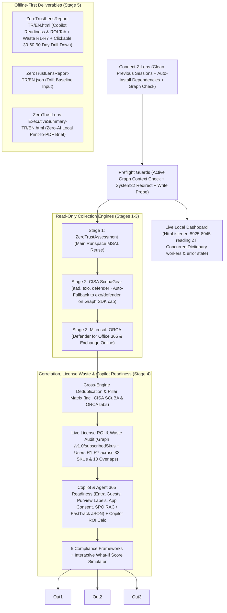

# ZeroTrustLens

**ZeroTrustLens** is a strictly **read-only**, bilingual (**Turkish / English**) Microsoft 365 & Azure security posture, **License ROI**, and **multi-framework compliance** assessment platform built around Microsoft's `ZeroTrustAssessment`, `CISA ScubaGear`, and `Microsoft ORCA`.

> **Why ZeroTrustLens?**
> Raw technical assessment exports list hundreds of `Passed / Failed` checks, leaving CISOs, security architects, and IT directors with three unanswered questions:
> 1. **Real License ROI & Blind Spots:** How much of our purchased Microsoft 365 E3/E5, Defender, Purview, and Copilot licensing is actually assigned vs. sitting idle (`USD/month` and `USD/year`), and which features are `Skipped` due to missing configuration?
> 2. **Multi-Framework Alignment:** How do M365, Entra ID, CISA SCuBA baselines, and Defender for Office 365 controls map simultaneously to **Microsoft Zero Trust**, **ISO/IEC 27001:2022**, **NIST CSF 2.0**, **CIS Microsoft 365 Foundations**, and **KVKK Technical Measures (TR)**?
> 3. **Zero-Telemetry Executive Action Plan:** Which high-risk findings fit into an interactive **0–30 / 31–60 / 61–90 day** roadmap, and can leadership export a Print-to-PDF brief without sending any tenant data to external AI services?

---

## Architecture & 5-Stage Execution Pipeline

`Invoke-ZtLensAssessment` runs `ZeroTrustAssessment` in the **main PowerShell runspace** (inheriting your authenticated MSAL/Graph, Azure, Exchange Online, and Security & Compliance tokens without re-prompting) while serving a local, real-time step-by-step dashboard on `http://localhost:8925–8945/`:



---

## Key Capabilities

- **Strictly Read-Only & Fail-Fast Auth Guard:** Never modifies tenant policies, Conditional Access rules, or Entra ID objects (nor calls `Disconnect-MgGraph` mid-session). Both `Connect-ZtLens` and `Invoke-ZtLensAssessment` validate `Get-MgContext` up front and abort cleanly if authentication is canceled.
- **Live Step-by-Step Browser Dashboard (`localhost:8925–8945`):** Directly reads `ZeroTrustAssessment`'s thread-safe `ProgressState` concurrent worker dictionary (`Running`, `Failed`, `Done`, phase counts, elapsed time) and surfaces PowerShell errors or disconnects immediately.
- **Cross-Engine Correlation (`ZeroTrustAssessment` + `CISA ScubaGear` + `ORCA`):** Automatically installs missing dependencies (`powershell-yaml`, `OPA`, `ScubaGear`, `ORCA`), handles ScubaGear 2.0.0's `'aad'` Graph reuse & `Control ID` schema, silently refreshes Exchange Online for ORCA if needed, and surfaces dedicated `CISA SCuBA` and `MDO / ORCA` views.
- **Copilot & Agent 365 Readiness (`Get-ZtLensCopilotReadiness`):** Integrates live Graph API readiness signals modeled on Microsoft FastTrack `Get-M365CopilotReadiness` & Microsoft `m365-copilot-automated-readiness-assessment` — checking eligible base suites, active Copilot seats, Entra guest invitation/role boundaries, Purview sensitivity labels, user OAuth app/plugin consent, and optional FastTrack `-InputFastTrackJsonPath` or live SharePoint RAC/Restricted Search checks with explicit L1–L4 maturity scoring and security warnings.
- **Live License ROI & Waste Hygiene (`Get-ZtLensLicenseRoi` + `Get-ZtLensLicenseWaste`):** Queries Graph `/v1.0/subscribedSkus` and `/v1.0/users` (inspired by `m365-license-review`) across **32 Microsoft SKUs** and **10 overlap rules** to detect unassigned seats, disabled licensed accounts (R1), 90+ day inactive licensed users (R2 when `AuditLog.Read.All` is granted), duplicate/overlapping SKUs such as `E5 + E3` / `E3 + EXO Plan 1` (R4), and licensed guests (R7).
- **Offline Interactive Copilot & Agent Studio ROI Calculator:** Inspired by `copilot-roi-calculator`, runs 100% locally inside the HTML report (`$30/user/mo` Copilot + `$200/tenant/mo` Studio + `$0.008/msg` PAYG, department presets, breakeven days, net annual ROI %, and **self-funded share from reclaimed M365 license waste**).
- **5 Selectable Compliance Frameworks & Zero-AI Print-to-PDF Brief:** Maps controls across `ZeroTrust`, `ISO27001`, `NIST_CSF_2`, `CIS_M365`, and `KVKK_TR`, generates an interactive 30-60-90 day drill-down + What-If simulator, and exports an offline executive PDF brief (`Compare-ZtLensReports` + `Export-ZtLensExecutiveSummary`).

---

## Exported Cmdlets

| Cmdlet | Purpose |
| --- | --- |
| `Connect-ZtLens` | Clears prior sessions, ensures dependencies, connects read-only to Graph/Azure/EXO/SCC, and verifies active context |
| `Invoke-ZtLensAssessment` | Orchestrates Stages 1–5 live or offline (`-InputReportJson`, optional `-InputFastTrackJsonPath`) and outputs HTML, JSON, and Executive Summary |
| `Get-ZtLensFrameworks` | Lists the 5 supported compliance frameworks and their TR/EN descriptions |
| `Get-ZtLensLicenseRoi` | Computes seat utilization and monthly idle USD estimate across 32 SKUs from `/v1.0/subscribedSkus` |
| `Get-ZtLensLicenseWaste` | Evaluates disabled users (R1), 90d inactive users (R2), unassigned seats (R3), overlapping SKUs (R4), and licensed guests (R7) |
| `Get-ZtLensCopilotReadiness` | Evaluates M365 Copilot & Agent 365 readiness, security warnings, and L1–L4 maturity score live or via FastTrack JSON |
| `Compare-ZtLensReports` | Compares a baseline and current `ZeroTrustLensReport-*.json` to list `Improved` and `Regressed` controls |
| `Export-ZtLensExecutiveSummary` | Generates a compact, offline Print-to-PDF executive brief from any `ZeroTrustLensReport-*.json` |

---

## Prerequisites

- **Live Tenant Assessment:** **PowerShell 7.6+** (`ZeroTrustAssessment v3.1.0` requires PowerShell 7.6+; tested on PowerShell 7.7)
- **Offline JSON Analysis (`-InputReportJson`):** **PowerShell 7.0+** (`pwsh`)
- **Required Module:** `ZeroTrustAssessment` (`Install-Module ZeroTrustAssessment -Scope CurrentUser`); `ScubaGear`, `OPA`, `powershell-yaml`, and `ORCA` are checked/installed automatically by `Connect-ZtLens` / `Invoke-ZtLensAssessment`
- **Minimum Read-Only Roles:** `Global Reader` (recommended for full M365 + Defender + Compliance coverage) or `Security Reader` + `Reports Reader`

---

## Quick Start

### 1. Clone & Import

```powershell
git clone https://github.com/canercetinkaya/ZeroTrustLens.git
cd ZeroTrustLens
Import-Module .\ZeroTrustLens.psd1 -Force
```

### 2. List Supported Frameworks

```powershell
Get-ZtLensFrameworks
```

### 3. Run Live Tenant Assessment (Read-Only)

```powershell
# Authenticate cleanly (auto-installs missing ScubaGear/OPA/ORCA dependencies)
Connect-ZtLens

# Run live assessment with real-time step dashboard & TR HTML/JSON/PDF Executive outputs
Invoke-ZtLensAssessment -OutputPath "$HOME\ZeroTrustLensReport" -Language tr -Framework All
```

### 4. Inspect License ROI, License Waste (R1–R7), Copilot Readiness & Historical Drift

```powershell
# Standalone License ROI query across 32 Microsoft SKUs
Get-ZtLensLicenseRoi | Format-Table ProductName, Purchased, Assigned, Unassigned, UtilizationPercent, EstimatedIdleUsdMo

# Audit disabled licensed users, 90d inactive accounts, licensed guests, and redundant SKU overlaps
Get-ZtLensLicenseWaste | Format-List

# Standalone M365 Copilot & Agent 365 readiness + security warnings (or ingest FastTrack JSON)
Get-ZtLensCopilotReadiness -Language tr
# Optional: Merge an existing FastTrack Get-M365CopilotReadiness export into ZeroTrustLens
Invoke-ZtLensAssessment -OutputPath "$HOME\ZeroTrustLensReport" -InputFastTrackJsonPath .\copilot-readiness.json -Language tr -Framework All

# Compare two historical JSON exports
Compare-ZtLensReports -BaselineJsonPath .\prev\ZeroTrustLensReport-TR.json -CurrentJsonPath .\curr\ZeroTrustLensReport-TR.json
```

### 5. Analyze an Existing `ZeroTrustAssessmentReport.json` Offline

```powershell
# Generate an anonymized English report from an existing export without tenant connectivity
Invoke-ZtLensAssessment `
  -InputReportJson .\ZeroTrustAssessmentReport.json `
  -OutputPath .\demo `
  -Language en `
  -Anonymize `
  -NoBrowser
```

---

## Demo Reports

Anonymized sample reports generated from an actual tenant export (showing the interactive dashboard, 5 frameworks, 30-60-90 day roadmap drill-down, What-If simulator, and offline Executive Summary) are included in `demo/`:

- [demo/ZeroTrustLensReport-TR.html](demo/ZeroTrustLensReport-TR.html) (Turkish Interactive Report)
- [demo/ZeroTrustLensReport-EN.html](demo/ZeroTrustLensReport-EN.html) (English Interactive Report)
- [demo/ZeroTrustLens-ExecutiveSummary-TR.html](demo/ZeroTrustLens-ExecutiveSummary-TR.html) (Turkish Print-to-PDF Executive Brief)
- [demo/ZeroTrustLens-ExecutiveSummary-EN.html](demo/ZeroTrustLens-ExecutiveSummary-EN.html) (English Print-to-PDF Executive Brief)

---

## Security, Privacy & Open-Source Attribution

- **Zero Telemetry & Zero External AI Exposure:** `ZeroTrustLens` sends no telemetry and never forwards tenant findings, user UPNs, or SKU counts to any external LLM/AI service.
- **Strict Read-Only Surface:** Relies solely on read-only assessment APIs (`GET /v1.0/subscribedSkus`, `GET /v1.0/users`, `GET /v1.0/policies/authorizationPolicy`, `ZeroTrustAssessment`, `ScubaGear`, `ORCA`).
- **Anonymization (`-Anonymize`):** Masks tenant domain identifiers before sharing reports externally.
- **Built With Respect to Community & Microsoft Open-Source Projects:** Copilot readiness signals and FastTrack JSON ingestion are modeled on [Microsoft FastTrack `Get-M365CopilotReadiness`](https://microsoft.github.io/FastTrack/#get-m365copilotreadiness) and [Microsoft `m365-copilot-automated-readiness-assessment`](https://github.com/microsoft/m365-copilot-automated-readiness-assessment) (without calling `Disconnect-MgGraph` mid-session); license waste and SKU overlap rules (`R1–R7`) draw from [`samuelgtetteh/m365-license-review`](https://github.com/samuelgtetteh/m365-license-review); the offline Copilot & Agent Studio ROI calculator draws from [`amitlals/copilot-roi-calculator`](https://github.com/amitlals/copilot-roi-calculator); and L1–L4 readiness maturity levels adapt the reporting UX of [`acreadiness-assess`](https://awesome-copilot.github.com/skill/acreadiness-assess/) (noting `acreadiness-assess` itself is a developer repository linter, not an M365 tenant scanner).

---

## Technical Article & License

- **Technical Deep-Dive (TR):** [ZeroTrustLens: Microsoft 365 Lisans ROI ve Çoklu Çerçeve Analizi](https://canercetinkaya.com/tr/blog/zerotrustlens-m365-lisans-roi-uyumluluk-analizi)
- **Technical Deep-Dive (EN):** [ZeroTrustLens: Read-Only M365 License ROI & Multi-Framework Analysis](https://canercetinkaya.com/en/blog/zerotrustlens-m365-lisans-roi-uyumluluk-analizi)
- **License:** MIT License — see [LICENSE](LICENSE).
